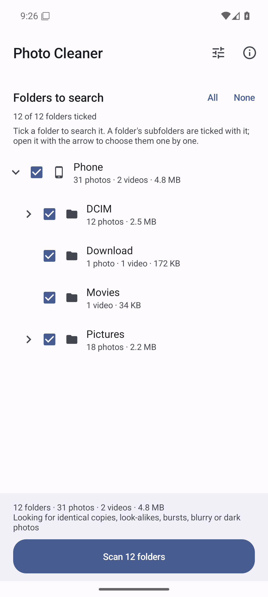
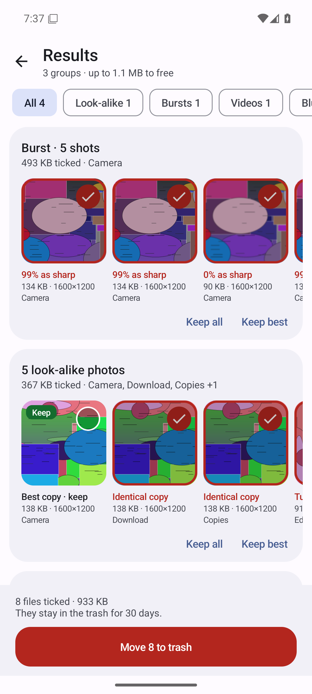
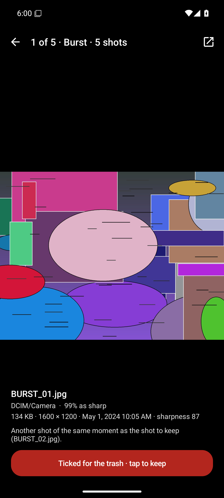

# Photo Cleaner

## [⬇ Download the latest APK](release/PhotoCleaner.apk?raw=true)

CI rebuilds the APK on every code push and puts it in `release/` once the on-device tests have passed
on Android 16 and 17, so the link points to the newest tested build. (Only if GitHub's artifact
storage fails does CI put the APK there before the device tests, so that they can fetch it.)

A duplicate photo and video cleaner for **Android 16 and 17** (minSdk 36, targetSdk 37).
**You choose the folders it searches.** In them it finds:

- **identical copies** of photos and videos, byte for byte;
- **look-alike photos**: copies that were resized, saved again, turned, mirrored or cropped;
- **burst shots**: photos taken a moment apart, of which it keeps the sharpest;
- **blurry, dark and badly exposed photos**, listed on their own.

For each group it suggests the copy to keep and ticks the files that are surely duplicates. Ticked
files go to Android's trash, where they stay for 30 days, and Undo brings them straight back.

Edits are kept. An edit (other brightness or colours, a sticker or a caption added, something
removed), a crop, a mirrored copy, a RAW file's JPEG twin and another shot of the same scene in
which part of the picture differs are versions of their own (frames of one burst are judged as a
burst): the best copy of each is kept, and only its own duplicates are ticked. A favourite, or a picture that merely has the same layout as
another (two pages of text, two screens of the same app), is never ticked for you.

Lean: Kotlin on the Android framework, **no libraries**, **no internet permission**, an APK of about 230 KB.
It works fully offline, and nothing leaves the phone. It reads your photos on **every processor
core** at once, and it is built not to fall over (see [Built to last](#built-to-last)).

*Screenshots are taken by CI on an Android 16 emulator, and replaced by every build that passes its tests.*

## Choosing the folders to search

The start screen lists every folder on the phone that holds photos or videos, as a tree under
**Phone** (and **SD card**, if there is one), each with its number of photos and videos and their size.

- **Tick a folder to search it.** Ticking a folder ticks everything below it. Open a folder with
  its arrow to tick or untick its subfolders one by one. A half-filled box means only some of a
  folder's subfolders are ticked.
- **All** and **None** tick or clear every folder at once.
- Chains of folders with nothing of their own are shown as one row, such as
  `Android/media/com.whatsapp/WhatsApp/Media`.
- **Your choice is remembered.** A folder that appears later is ticked automatically only if every
  folder was ticked; otherwise it shows a **New** badge and waits for you.
- **Only the ticked folders are read.** For example, tick `DCIM/Camera` and `WhatsApp Images` to
  find the photos you took that came back to you in a chat.

The bar at the bottom shows how many folders, photos and videos the scan will search, their size,
and what it looks for.

## Using it

1. **Allow access** to photos and videos. Choose *Allow all*: with *Select photos* the app can only
   compare the photos you picked, and it says so.
2. **Tick the folders** to search. The tune button at the top chooses what to look for: photos,
   videos, look-alikes, bursts, blurry and dark photos, and how alike look-alikes must be (strict,
   normal or loose).
3. **Scan.** The first scan reads what it needs of the ticked folders: every photo (only those that
   share their size with another, if you look for identical copies alone) and every video that
   shares its size with another. It remembers what it read, so later scans only read new and changed
   files. You can leave the app meanwhile: the scan carries on, and its
   notification shows how far it is.
4. **Review.** Every group has the copy to keep marked **Keep**; a red tick means a file goes to the
   trash. Tap a picture to see it at full size: pinch to zoom, swipe to the other copies, and read
   why it was ticked or kept. Tap the circle on a picture to tick or untick it. **Keep best** ticks
   the suggested files of a group again; **Keep all** unticks the group.
5. **Move to trash.** Android asks you to confirm, then the files go to its trash. **Undo** brings
   them back; so does the trash in the Files or Photos app, for 30 days.

## How it decides

The fingerprints, cut-offs and keep rules start from DupeFinder's, the desktop duplicate finder.

| Group | Found when | Suggested to keep |
|---|---|---|
| Identical copies | the files have the same size and SHA-256 (a video is read only when another one has its size) | a favourite; then one without a copy name such as "(1)" or " - Copy"; then one in a camera, screenshots or screen-recordings folder; then the first added |
| Look-alike photos | their 64-bit perceptual hashes (pHash) differ in at most 8 bits (strict 4, loose 12), also against the other photo turned, mirrored or cropped to its centre, **and** their fine fingerprints (below) differ in at most 48 of 255 bits (strict 16), unless the two clearly differ in colour | the one with the most pixels (a favourite first, among those), then the largest file of its kind (see *Two formats*) |
| Burst shots | photos from the same camera (EXIF make and model; photos that name none count as one camera), each taken at most 3 seconds after the one before, whose hashes differ from it in at most 16 bits and whose fine fingerprints in at most 56; RAW files and the other photos form bursts of their own | a starred frame, else the sharpest (Laplacian detail, halved for a dark or clipped shot) |
| Blurry and dark photos | a photo from a camera (its EXIF data names the camera or the moment), in no other group, with sharpness below 45 of 100 (a re-blur measure of the 4 sharpest of 16 tiles), median brightness below 40, or more than 25 % of pixels near black or white (0 to 5, 250 to 255) | never ticked: decide yourself |

**The fine fingerprint.** A 64-bit pHash only sees a picture's layout. Of 1,770 pairs of different
text pages generated for the tests, 10 are within 8 bits of each other and 27 % within the 16 bits
of a burst: by the pHash alone, pages of a document photographed one after the other could count as
a burst, and all but one be ticked. The app therefore also compares the signs of the 16 x 16 lowest
frequencies of the same transform (255 bits). In the same tests, copies resized to half or saved
again differ in at most 8 of them, a quarter-size copy (200 to 256 px) in up to 20 and a copy cut by
a hundredth in up to 31; different pages and screens, however alike their layout, in 61 or more.

**Versions.** Within a group, files that are surely the same picture, unedited, form a version. Each
of these is a version of its own: a mirrored or cropped copy; one whose brightness, contrast or
colours differ by more than saving or resizing changes them (a filter, black and white, a brighter
version); one that differs in part of the picture; a RAW file's JPEG twin; a look-alike that isn't
surely the same picture; and the same photo in another format at the same size, unless one of the
two is where originals are made. The best copy of every version is kept, and every other file is
compared with the kept copy of its own version. So an edit's duplicates go while the edit stays, and
the original's duplicates go even when the edit is the larger file. A camera that saves every shot
as a RAW file and a JPEG gives two bursts, and the sharpest of each is kept.

**Part of the picture.** The fingerprints above describe a picture as a whole, and a copy with a
small sticker, a date stamp or a drawn circle on it, or with something removed, passes all of them:
in a test with generated photos, every such copy was taken for a plain duplicate. So the app also
keeps a grid of 16 x 16 cells for every photo, with the mean brightness and colour of each (768
bytes). Two files are the same picture only if no cell differs by 6 or more in brightness, or by 5
or more in colour, beyond what they differ by all over. More is allowed when the smaller of the two
is under 400 px on its long side, where a cell holds few pixels: (400 / long side)² times as much,
at most 8 times. Measured on 32 generated photos, 464 copies saved again or resized (JPEG quality 55
to 95, 400 to 4000 px, sharpened, saved twice) kept every cell within 2.98 of brightness and 2.18 of
colour, while a sticker 2.5 % of the picture's width, a date stamp, a drawn circle or a replaced
object took a cell past the limits in each of 12 photos. Two shots of one scene taken a moment
apart, which no burst links because a chat app removed their capture times, are told apart the
same way. The grids stay on disk and are read only for the photos about to be taken for copies.

What this can't see: a change that leaves every cell's averages nearly as they were, such as a
small area blurred, pixelated or retouched (in none of 12 photos was it seen), or a line a few
pixels thin (missed in 3 of 12). Such a copy still counts as a duplicate, so look at what is ticked before you
move it if you make edits like that.

**Two formats.** Of two copies with as many pixels, the larger file is the better one only if both
are files of one kind. A HEIC photo is a smaller file than the JPEG made from it, and the JPEG is the
copy: "keep the larger file" would keep the conversion and tick the original. So between two
formats at the same size, the copy from where originals are made (the camera's folder, the
screenshots) is kept and the other ticked; where that doesn't tell them apart, both are kept and
you decide. A smaller copy goes whatever its format.

**What is ticked for you** is only what is sure:

- identical copies;
- look-alikes within 8 pHash bits and 32 fine bits of the kept copy of their version (4 and 16 with
  "Strict"; "Loose" finds more, but ticks no more than "Normal"), as they are or turned, alike in
  brightness and colour as a whole and in every part of the picture;
- burst frames within 16 pHash bits and 56 fine bits of the kept shot (a different moment of a long
  burst is left alone).

**Never ticked for you:**

- the best copy of any version: the original, an edit, a crop, a mirrored copy, the RAW file, its
  JPEG, the same photo in another format when it can't be told which is the original;
- favourites. Among copies as large (and among the frames of a burst) the starred one is the copy
  to keep; a starred small copy is kept as well, and never makes the full-size photo the duplicate;
- a file that only matches another member of its group, not the copy kept;
- a file you unticked before: what you keep by hand stays kept in every later scan (up to 20,000
  files).

When every copy of a picture, or of one of its versions, is ticked, the app asks before moving them
all. The last copy left of anything is never ticked where you can't see it: when the kept copy of a
version has gone (deleted in another app, say), the last copy left of it is unticked.

## Every core

Scanning is spread over all the processor's cores, the way the LINPACK benchmark app and Lean
Reader do it:

- **One reading thread per core**, as far as free memory allows (Lean Reader's rule: threads =
  min(cores, free memory / memory per thread)). The scan screen says how many are working.
- **Files are handed out one at a time** from a shared counter, so on a phone with fast and slow
  cores (big.LITTLE) the fast ones take more and every core keeps working until the last file.
- **Each file is opened once.** Its SHA-256, its capture time and camera, and its pixels all come
  from that one open. With the photos' own bytes allowed (see [Privacy](#privacy)), Android hands
  out the file itself: it doesn't search every photo for location data first, and reads don't pass
  through its filter.
- **Each thread keeps its own buffers** (the grey copy, the noise filter's output, a read buffer and
  its SHA-256 state), so reading a photo allocates little on the Java heap and the garbage collector
  seldom has work to do. A file is hashed as it streams in, never held in memory whole, and photos
  are decoded in sRGB.
- **Photos are decoded the decoder's quick way.** JPEG and WebP decoders reduce a photo with every
  pixel as they decode: a JPEG decoder by 2, 4 or 8. Asked for any other size (1024 px of a 4000 px
  photo), Android decodes the JPEG whole, keeps every third pixel and scales the rest, which takes
  longer and leaves jagged detail (with Pillow's libjpeg-turbo on a desktop, a 12-megapixel photo
  took 51 ms whole and 26 ms at a quarter, a 50-megapixel one 248 ms whole and 92 ms at an eighth).
  So the app asks for the largest power of two that leaves at least 960 px (the phones' usual 4000,
  4032, 4080 and 8160 px come out at 1000 to 1020 px), and reduces what is still over 1024 px the
  rest of the way itself, smoothly. The other decoders don't reduce with every pixel (a PNG decoder
  keeps every n-th one; HEIC and GIF pictures are decoded whole and shrunk with a bilinear filter,
  AVIF pictures by their own library), so they are asked for half the reduction, and the app
  averages the last halving: blur is measured alike in every format.
- **The noise filter is the quick kind.** Before a photo's sharpness is measured, its noise is
  filtered out with a median filter: 3 x 3 for a moderately noisy photo, 5 x 5 for a very noisy one.
  Done with a sliding histogram, the 3 x 3 filter was half the work of analysing a photo. Now every
  column of three pixels is sorted once and shared by the three windows it is in: about 4.5 ms for
  a 1024 x 768 photo instead of 20, with the same values, and 22 ms instead of 36 for the whole
  analysis (on a desktop's JVM). The 5 x 5 window keeps the sliding histogram, updated without
  branches (about 19 ms).
- **Decoders share a memory budget.** JPEG, PNG and WebP pictures are decoded reduced. HEIC, AVIF
  and GIF pictures are decoded whole first and a RAW file is developed whole: by the app's estimate
  a 50-megapixel HEIC takes over 300 MB for a moment, a RAW file of that size 1.2 GB. When memory is
  short, decoders wait their turn (first come, first served, so a large photo is never kept waiting
  by a stream of small ones), and a need larger than the whole budget is met on its own.
- **Comparing** every pair of photos runs on all cores too (from 256 photos on), in chunks of equal
  work handed out the same way, and shows how far it is.
- The reading threads run one notch below normal priority: the phone stays smooth, and they aren't
  moved to the slow cores, as threads at background priority can be. The processor is kept awake
  while a scan runs, so it doesn't stall when the screen goes off.

## Built to last

- **A file that fails never stops a scan.** A photo that can't be decoded, a truncated file, a text
  file with a photo's name: each is reported and skipped. Files that ran out of memory, couldn't be
  read or couldn't be decoded get a second try at the end, one at a time, in case the crowd was the
  cause.
- **A file that hangs is given up** after a minute (plus a second per 10 MB), and a spare thread
  takes the place of the one it holds (up to four spares a pass). The memory its decoder holds is
  written off, so no other photo waits for it. If the storage stops answering altogether (a failing
  SD card), the rest is given up too: a scan always ends.
- **A photo that makes the app die is found and left out.** A crash inside a picture decoder can't
  be caught: the app is gone. The app notes which files it is reading in a small journal. When it
  has died while reading, the next scan reads the files that were in flight one at a time. If
  Android's record of how the app ended names a crash, a signal, low memory or excessive resource
  use, a file that was being read on its own is left out from then on (until it changes). One bad photo can stop a scan
  twice, never a third time. When you close the app or stop the scan, no file is blamed.
- **When the phone gets hot**, the scan lets only half its threads work (one when the heat is
  critical) until it cools down, so the scan slows down rather than the whole phone.
- **Nothing is lost when Android closes the app.** What has been read is saved as the scan goes, so
  a scan that was stopped carries on from there the next time. If the app is closed while its
  results are open, they come back when you return, with your ticks.
- **Files that changed meanwhile are checked.** Before moving files to the trash, and after Android
  answers, the app checks which files are really there, in every group that has a tick. It never
  acts on or reports a file another app has deleted, and if a deleted file leaves a ticked copy as
  the last one, that copy is unticked. The folder list updates by itself when photos arrive.
- **A damaged cache is rebuilt**, and a full storage only means fingerprints aren't kept this time.
  The folder choice for an SD card is kept while the card is out.

## Privacy

- **No internet access.** The app doesn't have the permission, so it can't send anything anywhere.
- **What it asks for:** your photos and videos; notifications, for a scan's progress; to run a scan
  as a foreground service and keep the processor awake during it; and the photos' own bytes
  (Android's "media location" permission, part of the same question as the photos). Without the
  last one Android hands out copies with the place a photo was taken blanked out, so "identical"
  would not quite mean byte for byte. The app doesn't read or show where a photo was taken.
- **The fingerprint cache stays on the phone**, in the app's private storage, and isn't backed up.
- **Nothing is deleted for good** by the app: files go to Android's trash, which empties itself
  after 30 days.

## Build

JDK 17 or later and Android SDK 37: `./gradlew assembleRelease`. The **Build APK** workflow runs on
every code push. It runs the unit tests and lint, builds the minified APK, runs the on-device test
on Android 16 and 17 emulators, and commits the APK to `release/` when both have passed.

All builds are signed with `app/photo-cleaner.keystore`, so updates install over each other and keep
your folder choice and fingerprint cache. The repository is public, so anyone can sign an APK with
this key: it is only fit for sideloading your own builds. Use a private key for any store release.

## Tests

| What | How |
|---|---|
| JVM tests (104): perceptual hashes and fine fingerprints of synthetic photos (resized, saved again, turned, mirrored, cropped, grey), blur, noise, exposure, brightness and contrast measures, the median filter against a naive one, reused per-thread buffers giving the same answers as fresh ones; every formula at its edges (colour, contrast, exposure, area resizing, the DCT against a naive one, the centre crop, flat pictures, the grid's limits and their widening for small pictures, the smallest picture whose sharpness is measured, the noise estimate, the option limits); the grid of local brightness and colour (re-saves keep it, a sticker, a caption or a shift doesn't, turned copies are compared turned); every grouping and keep rule (identical, look-alike, turned, mirrored, cropped, edited, edited in part, RAW twins, the same photo in two formats, versions that each keep their best copy chosen among their own files, linked through another file, bursts, RAW and JPEG bursts, their copies and far frames, colour, favourites, flat pictures, videos, poor shots, every combination of options, matching on many threads, stopping and progress); 60 different text pages and 40 app screens that a pHash confuses must never be grouped, nor pages photographed one after the other be a burst; the thread count, the power-of-two reduction photos are decoded at, the memory each decoder needs, capture times, time limits, heat rules, the decoders' memory budget (also with a decoder that hangs) and the crash journal; what is ticked in the results, what is remembered, and that the last copy of a picture or of a version never stays ticked; from the media index's and the reading's values to the matcher, the groups, the ticks, the words on screen, the trash and back; the folder tree, tick boxes, how new folders are treated and the sizes shown; copy names, sizes and counts | `./gradlew testDebugUnitTest` |
| On-device test on Android 16 and 17 emulators: copies test photos to the phone (`scripts/make_test_photos.py`), including five document pages photographed 2 s apart and two settings screens that a pHash takes for a burst and for look-alikes, an edited version with a copy of its own, a copy with a sticker on it, an 8000 px panorama with a quarter-size copy and a WebP twin, a HEIC photo with the larger JPEG made from it, a truncated photo, a text file with a photo's name, and a screen recording with its copy; scans three different sets of folders and checks every group found, what is ticked and what is left alone, and the broken files reported; moves the ticked files to the trash through the real button and Android's own dialog, checks the media index, undoes it; has Android close the app while its results are open and checks the same results come back; with a test build that dies on purpose while reading one photo, checks that the photo is left out by the third scan; rotates, and runs 15,000 random GUI events (monkey); fails on any wrong result, crash or ANR | `scripts/device-test.sh` (CI) |
| Static analysis: Android lint | `./gradlew lintDebug` |

## Code

| File | What it does |
|---|---|
| `core/ImageAnalysis.kt` | pHash with its turned, mirrored and centre-crop variants, the fine fingerprint, the grid of local brightness and colour, area resizing, sharpness (re-blur measure, Laplacian tiles, noise estimate, median filter), exposure, brightness and contrast |
| `core/Matcher.kt` | links identical files, look-alikes and burst frames, forms groups, splits them into versions (edits, crops, RAW twins, other formats), picks the copy to keep of each, and decides what to tick |
| `core/FolderTree.kt` | the folder tree, its tick boxes, and the selection kept between runs |
| `core/Names.kt` | copy names, original folders, kinds of picture file, capture times, sizes and counts |
| `core/Parallelism.kt` | how many threads a scan runs, the reduction photos are decoded at, how long a file may take, how many threads rest when the phone is hot, and the memory budget decoders share |
| `core/Journal.kt` | the note of files being read, which finds a photo that makes the app die |
| `media/MediaIndex.kt` | reads photos, videos and storage volumes from Android's media index |
| `media/Analyzer.kt` | opens a file once and reads its SHA-256, EXIF capture time and camera, and its pixels reduced to at most 1024 px |
| `media/FeatureCache.kt` | the fingerprint cache (SQLite), so later scans only read new files; the grids are read from it one by one |
| `media/Thumbs.kt` | thumbnails and full-size pictures, off the main thread |
| `scan/Scanner.kt` | a scan of the ticked folders: the threads on every core, the watchdog and its spare threads, the second tries, the heat limit, the crash quarantine |
| `scan/ScanService.kt`, `scan/ScanState.kt` | the scan as a foreground service with a notification and a wake lock, and its results and ticks |
| `Prefs.kt` | what is kept between runs: the folders, the options, the choices made by hand, the files to read alone after a crash |
| `ui/FoldersScreen.kt` | the folder list with tick boxes, the options and the about box |
| `ui/ScanScreen.kt`, `ui/ResultsScreen.kt`, `ui/ViewerScreen.kt` | progress, the groups found, and one file at full size |
| `ui/Ui.kt`, `ui/Screen.kt`, `ui/Bg.kt`, `ui/ZoomImageView.kt` | the colours from the wallpaper and the views every screen is built of, a screen's life, small jobs off the main thread, and pinch-zoom |
| `MainActivity.kt` | screens, Back, permissions, and Android's trash confirmation |
